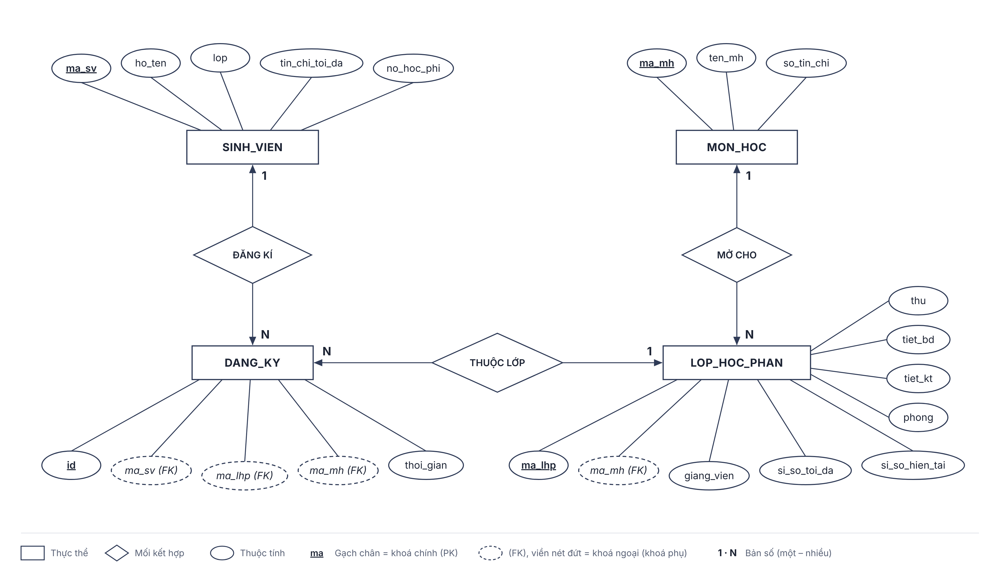
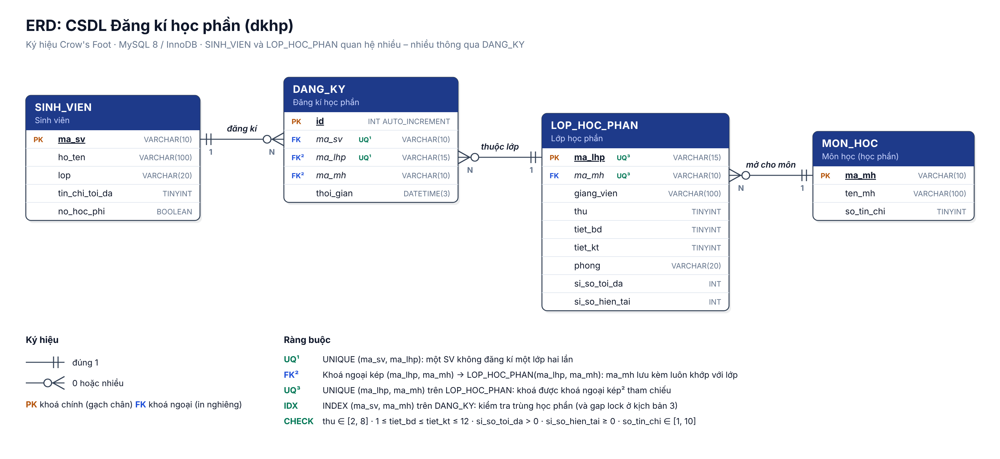
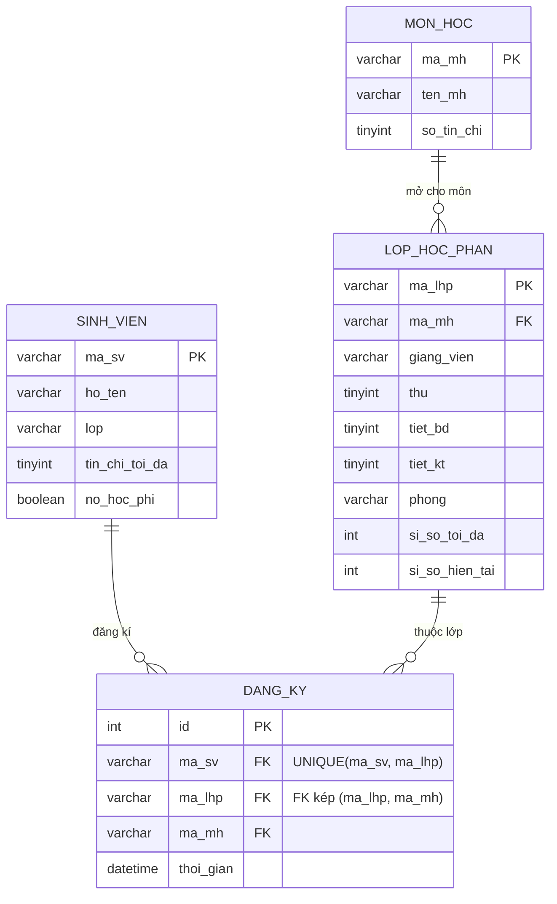

# Đăng kí học phần: giả lập xung đột dữ liệu đồng thời

Đồ án môn **Hệ quản trị cơ sở dữ liệu**, dùng **MySQL 8 (InnoDB)**.

Project là một trang web đơn giản chỉ có chức năng đăng kí học phần, kèm phần **giả lập xung đột dữ liệu** khi nhiều người đăng kí cùng lúc. Mỗi xung đột có bản lỗi và bản đã sửa để so sánh.

| Phần | Nội dung | Thành viên |
|---|---|---|
| SV đăng kí | CSDL, dữ liệu mẫu, trang đăng kí/huỷ, `sp_dang_ky`; kịch bản 4 (dirty read) | (điền tên) |
| Tranh slot | Kịch bản 1: Lost update | Minh Hiếu |
| Trùng lịch đồng thời | Kịch bản 2: Phantom / Write skew | Phúc Hoàng |
| Trùng học phần | Kịch bản 3: Phantom khi chèn | Đoàn Thịnh |

---

## 1. Cài đặt và chạy

**Cách nhanh nhất (Windows):** cài Node.js và MySQL 8, rồi **bấm đúp file `chay-web.bat`**. File này tự cài thư viện, hỏi mật khẩu MySQL (sai thì hỏi lại, đúng thì lưu vào `.env`), tạo CSDL, chọn cổng trống và mở trình duyệt vào trang demo. Trên macOS / Linux dùng lệnh `npm run chay`.

Hoặc làm từng bước:

Cần có **MySQL 8** và **Node.js 18 trở lên**.

```bash
npm install
```

Sao chép file `.env.example` thành `.env`, rồi điền `DB_USER` / `DB_PASSWORD` của MySQL trên máy bạn.

```bash
npm run db:init
```

```bash
npm start
```

Mở http://localhost:3000 (trang demo). Trang đăng kí đầy đủ nhiều tab ở http://localhost:3000/day-du.html.

- `npm run db:init` tạo CSDL `dkhp` (**xoá CSDL `dkhp` cũ nếu có**), các bảng, view, stored procedure và dữ liệu mẫu. Cách khác: mở 3 file trong `sql/` bằng MySQL Workbench và chạy lần lượt `01_schema.sql` → `02_procedures.sql` → `03_seed.sql`.
- `npm run demo` chạy cả 4 kịch bản ngay trên terminal và in lịch thao tác (thêm `-- 2` để chỉ chạy kịch bản 2).
- `npm test` chạy 13 test tự động: bản lỗi phải ra xung đột, bản sửa phải ra dữ liệu đúng, `sp_dang_ky` kiểm tra đúng mọi quy tắc. **Test sẽ nạp lại dữ liệu mẫu.**
- Chưa có MySQL thì có thể chạy bằng Docker: `docker compose up -d` (MySQL 8.4, user `root`, mật khẩu `root`).

## 2. Trang web

**Trang demo, cũng là trang chính** (`http://localhost:3000`): gộp 4 trường hợp vào một màn hình để trình bày: **Tranh slot**, **Trùng lịch đồng thời**, **SV đăng kí** (đăng kí bị huỷ giữa chừng), **Trùng học phần**. Mỗi trường hợp chỉ có 2 nút: **Chạy khi CHƯA xử lý** và **Chạy khi ĐÃ xử lý**; trang hiện bạn A, bạn B, hình minh hoạ dữ liệu (ghế trong lớp / thời khoá biểu / môn đã học), kết quả ✅ / ❌ và diễn biến từng bước.
- Chọn tình huống: **Tranh slot**, **Trùng lịch đồng thời**, **Trùng học phần**, **Đọc dữ liệu chưa COMMIT**. Sinh viên và lớp được điền sẵn, dữ liệu tự đặt lại.
- Hai khung **Sinh viên A** và **Sinh viên B** đặt cạnh nhau, mỗi khung có nút Đăng kí riêng: mỗi lần bấm là một giao dịch thật trên một kết nối MySQL riêng.
- Gạt **CÓ / KHÔNG xử lý**, rồi bấm **Cho A và B bấm cùng lúc** (hoặc tự bấm hai nút trong khoảng xử lý chậm).
- Trang hiện: giao dịch nào đang chờ, kết quả từng bên, dữ liệu đã COMMIT trong MySQL (sĩ số, ai đã vào lớp), kết luận ✅ / ❌ lấy từ view kiểm tra toàn vẹn, lịch thao tác A/B, nguyên nhân và cách sửa kèm SQL.

**Trang đăng kí đầy đủ** (`/day-du.html`) có 3 tab.

**Tab "Đăng kí học phần"**: phần chính, xung đột được mô phỏng ngay trên trang này.
- Khung **Mô phỏng xung đột trên trang này** có công tắc **CÓ xử lý / KHÔNG xử lý** và ô **xử lý chậm** (0, 3, 5 hoặc 8 giây). Nút Đăng kí gọi `sp_dang_ky_mo_phong(ma_sv, ma_lhp, co_xu_ly, tre)`:
  - CÓ xử lý: khoá dòng sinh viên và dòng lớp bằng `SELECT ... FOR UPDATE`;
  - KHÔNG xử lý: đọc thường, không khoá, ghi sĩ số bằng giá trị đã đọc.
- Cách mô phỏng: mở **2 cửa sổ trình duyệt** cạnh nhau. Mỗi cửa sổ là một sinh viên, tức một giao dịch. Chế độ chọn ở cửa sổ này tự áp dụng sang cửa sổ kia. Bấm Đăng kí ở cả hai cửa sổ trong khoảng thời gian xử lý chậm:

  | Tình huống | Cửa sổ 1 | Cửa sổ 2 | KHÔNG xử lý | CÓ xử lý |
  |---|---|---|---|---|
  | Tranh slot | SV09 → KTCT.02 | SV10 → KTCT.02 | lớp 1 chỗ có 2 SV, sĩ số lưu = 1 | cửa sổ 2 chờ khoá, rồi nhận "Lớp đã đủ sĩ số" |
  | Trùng lịch | SV09 → CSDL.01 | SV09 → CTDL.01 | 2 lớp trùng giờ | "Trùng lịch với lớp CSDL.01" |
  | Trùng học phần | SV10 → CSDL.01 | SV10 → CSDL.02 | 2 lớp cùng môn | "Trùng học phần ..." |

  Trước mỗi lần thử, bấm **Khôi phục dữ liệu mẫu**. Trang tự làm mới mỗi 2 giây nên cửa sổ này thấy ngay thay đổi do cửa sổ kia gây ra.

Các chức năng khác của tab này:
- Chọn sinh viên, xem các lớp đang mở (sĩ số dạng thanh), bấm **Đăng kí** hoặc **Huỷ**. Nút Đăng kí gọi `sp_dang_ky_mo_phong`, nút Huỷ gọi `sp_huy_dang_ky`.
- Thủ tục đăng kí từ chối khi: lớp đã đầy, đã đăng kí lớp đó, trùng học phần, trùng lịch, vượt số tín chỉ tối đa, hoặc còn nợ học phí.
- Thời khoá biểu tô **đỏ** các lớp trùng giờ.
- Khung **Kiểm tra toàn vẹn dữ liệu** đọc view `v_kiem_tra_toan_ven` và liệt kê các vi phạm: vượt sĩ số, sai sĩ số, trùng lịch, trùng học phần, vượt tín chỉ.

Dữ liệu mẫu có sẵn vài tình huống để thử:
- `PLDC.01` đã đầy.
- `SV07` chỉ được đăng kí tối đa 8 tín chỉ.
- `SV08` còn nợ học phí.
- `SV01` đã học `CSDL.01`: thử đăng kí `CTDL.01` sẽ bị báo trùng lịch, `CSDL.02` sẽ bị báo trùng học phần.

**Tab "Giả lập xung đột"**: chạy tự động (không cần bấm tay) và vẽ lịch thao tác T1/T2. Mỗi kịch bản có 2 nút **Chạy KHÔNG xử lý** và **Chạy CÓ xử lý**. Kết quả gồm:
- bảng **lịch thao tác** theo kiểu sách giáo khoa (cột thời điểm | T1 | T2 | …). Thời điểm do chính MySQL ghi bằng `SYSDATE(3)`, có ghi chú "⏳ đã chờ x giây" khi một giao dịch phải đợi khoá;
- kết luận ✅ / ❌ kèm số liệu kiểm tra sau khi chạy;
- phần giải thích nguyên nhân và cách sửa, kèm đoạn SQL.

**Tab "Thiết kế CSDL"** hiện ERD và dữ liệu thô của từng bảng (`SELECT *` trực tiếp từ MySQL). Sau mỗi kịch bản có thể mở bảng `dang_ky` hoặc view `v_kiem_tra_toan_ven` để chỉ cho người xem dòng dữ liệu bị sai.

Sau khi chạy bản lỗi, quay lại tab 1 và chọn SV của kịch bản đó để xem dữ liệu sai trên trang chính (ví dụ SV16 có 2 lớp đỏ trong thời khoá biểu).

## 3. Thiết kế CSDL

### ERD (mô hình thực thể – kết hợp, ký hiệu Chen)



Chữ nhật là thực thể, elip là thuộc tính (gạch chân là khoá chính), hình thoi là mối kết hợp. Bản vector: [`docs/erd-chen.svg`](docs/erd-chen.svg).

### Lược đồ quan hệ (ký hiệu Crow's Foot)



Bản vector để chèn vào báo cáo: [`docs/erd.svg`](docs/erd.svg). Muốn có EER diagram do MySQL Workbench tự vẽ thì chạy `db:init` xong vào *Database → Reverse Engineer…* và chọn schema `dkhp`.

`SINH_VIEN` và `LOP_HOC_PHAN` có quan hệ **nhiều – nhiều**, được tách thành thực thể kết hợp `DANG_KY`:
- một SV đăng kí 0..N lớp, một lớp có 0..N SV đăng kí;
- một môn học mở 0..N lớp, mỗi lớp thuộc đúng 1 môn.



### Lược đồ quan hệ

```
SINH_VIEN(ma_sv, ho_ten, lop, tin_chi_toi_da, no_hoc_phi)
MON_HOC(ma_mh, ten_mh, so_tin_chi)
LOP_HOC_PHAN(ma_lhp, ma_mh → MON_HOC, giang_vien, thu, tiet_bd, tiet_kt, phong, si_so_toi_da, si_so_hien_tai)
DANG_KY(id, ma_sv → SINH_VIEN, (ma_lhp, ma_mh) → LOP_HOC_PHAN, thoi_gian)
    UNIQUE (ma_sv, ma_lhp)                        -- không đăng kí 1 lớp 2 lần
    INDEX  (ma_sv, ma_mh)                         -- kiểm tra trùng học phần
```

Bảng `dang_ky` lưu kèm `ma_mh` để kiểm tra trùng học phần bằng index và để có thể thêm `UNIQUE(ma_sv, ma_mh)`. Khoá ngoại kép bảo đảm cột lưu kèm này không bị sai lệch so với lớp.

**Cách giả lập.** Mỗi thủ tục `sp_..._loi` / `sp_..._an_toan` nhận tham số `p_tre`. Đây là số giây `DO SLEEP(p_tre)` chèn giữa bước **đọc/kiểm tra** và bước **ghi**, tương đương `WAITFOR DELAY` trong SQL Server. Web chạy mỗi giao dịch trên một kết nối riêng, bắt đầu lệch nhau 100 đến 500 ms, nên các giao dịch chắc chắn chen vào giữa nhau. Hai bản của mỗi cặp thủ tục chỉ khác nhau ở các dòng đánh dấu `[SỬA]`.

---

## 4. Bốn kịch bản xung đột

### Kịch bản 1: Tranh slot (Lost update)

5 SV (SV11 đến SV15) cùng đăng kí lớp `HQT.03`, lớp chỉ có 2 chỗ.

| t | T1 (SV11) | T2 (SV12) | … T5 |
|---|---|---|---|
| 0.0 | Đọc sĩ số = 0/2 → còn chỗ | | |
| 0.1 | | Đọc sĩ số = 0/2 → còn chỗ | (cũng đọc 0/2) |
| 2.0 | Ghi `si_so_hien_tai = 0 + 1`, COMMIT | | |
| 2.1 | | Ghi `si_so_hien_tai = 0 + 1`, COMMIT | … |

**Kết quả sai:** cả 5 SV vào lớp 2 chỗ, cột `si_so_hien_tai` chỉ là 1. Bản ghi sau đè lên bản ghi trước nên mất cập nhật.

**Nguyên nhân:** `SELECT` thường không khoá. Mọi giao dịch đọc cùng một giá trị cũ rồi ghi đè lên nhau.

**Cách giải quyết:** đọc có khoá bằng `SELECT ... FOR UPDATE`. Khoá X giữ đến khi COMMIT nên T2 đến T5 phải chờ, đến lượt thì đọc sĩ số mới nhất. Kết quả: 2 SV thành công, 3 SV bị từ chối "Lớp đã đủ sĩ số".
Cách khác: `UPDATE ... SET si_so_hien_tai = si_so_hien_tai + 1 WHERE si_so_hien_tai < si_so_toi_da` rồi kiểm tra `ROW_COUNT()`.

### Kịch bản 2: Trùng lịch đồng thời (Phantom / Write skew)

SV16 mở 2 tab, cùng lúc đăng kí `CSDL.01` (Thứ 2, tiết 1-3) và `CTDL.01` (Thứ 2, tiết 2-4).

| t | T1 (CSDL.01) | T2 (CTDL.01) |
|---|---|---|
| 0.0 | Kiểm tra lịch: không trùng | |
| 0.3 | | Kiểm tra lịch: không trùng (dòng của T1 chưa COMMIT nên T2 không thấy) |
| 2.0 | INSERT, COMMIT | |
| 2.3 | | INSERT, COMMIT |

**Kết quả sai:** SV16 có 2 lớp trùng giờ.

**Nguyên nhân:** hai giao dịch chèn **hai dòng khác nhau**, nên không dòng nào bị cả hai cùng khoá. Mỗi bên đúng khi xét riêng, ghép lại thì sai (write skew). Dòng mới của bên kia là "bóng ma" (phantom) đối với điều kiện đã kiểm tra. Khoá dòng lớp học phần cũng không giúp gì vì hai bên đăng kí hai lớp khác nhau.

**Cách giải quyết:** khoá "dòng cha" chung là `SELECT ... FROM sinh_vien WHERE ma_sv = ? FOR UPDATE`. Mọi lần đăng kí của cùng một SV vì vậy chạy tuần tự: T2 chờ T1 COMMIT, sau đó thấy `CSDL.01` và từ chối.
⚠ Lệnh khoá phải là **câu đầu tiên** của giao dịch. Ở REPEATABLE READ, snapshot được chụp ở lần `SELECT` thường đầu tiên. Nếu đọc trước rồi mới khoá, T2 vẫn kiểm tra trên snapshot cũ và không thấy dòng của T1.

### Kịch bản 3: Trùng học phần (Phantom khi chèn)

SV17 cùng lúc đăng kí `HQT.01` và `HQT.02`. Hai lớp khác giờ nhưng cùng môn Hệ quản trị CSDL.

**Kết quả sai:** cả hai giao dịch chạy `SELECT COUNT(*) ... WHERE ma_sv = ? AND ma_mh = 'HQT'`, đều được 0, rồi cùng INSERT, nên SV17 học 2 lớp của 1 môn. `UNIQUE(ma_sv, ma_lhp)` không chặn được vì hai lớp có mã khác nhau.

**Cách giải quyết 1: mức cô lập `SERIALIZABLE`.** InnoDB biến `SELECT` thành `SELECT ... FOR SHARE` và khoá cả **khoảng trống** (gap/next-key lock) trên index `(ma_sv, ma_mh)`. Diễn biến:

| t | T1 (HQT.01) | T2 (HQT.02) |
|---|---|---|
| 0.0 | Kiểm tra: chưa có, giữ khoá S trên khoảng (SV17, HQT) | |
| 0.3 | | Kiểm tra: chưa có, cũng giữ khoá S trên khoảng đó |
| 2.0 | INSERT: chờ khoá S của T2 | |
| 2.3 | | INSERT: chờ khoá S của T1 → **DEADLOCK 1213**, InnoDB ROLLBACK T2 |
| 2.3 | INSERT xong, COMMIT | Ứng dụng thử lại: thấy đã có HQT.01 → từ chối |

**Cách giải quyết 2: ràng buộc `UNIQUE(ma_sv, ma_mh)`.** Đây là lớp bảo vệ cuối: DBMS tự chặn dòng trùng (lỗi 1062), kể cả khi code ứng dụng sai. Xem `sql/demo/3_trung_hoc_phan.sql`.

### Kịch bản 4: Đăng kí bị huỷ giữa chừng (Dirty read)

Lớp `KTCT.02` còn 1 chỗ. T1: SV18 giữ chỗ trước (UPDATE và INSERT, chưa COMMIT), sau đó mới kiểm tra học phí, thấy nợ học phí nên **ROLLBACK**. T2: SV19 đăng kí cùng lớp trong lúc T1 chưa kết thúc.

| t | T1 (SV18) | T2 (SV19) |
|---|---|---|
| 0.0 | Giữ chỗ: sĩ số 0 → 1/1 (chưa COMMIT) | |
| 0.5 | | READ UNCOMMITTED: đọc 1/1 → "Lớp đã đủ sĩ số" |
| 2.0 | Nợ học phí → ROLLBACK, lớp về 0/1 | |

**Kết quả sai:** SV19 bị từ chối oan, lớp vẫn còn trống.

**Nguyên nhân:** T2 đọc dữ liệu chưa COMMIT, và dữ liệu đó sau cùng bị huỷ.

**Cách giải quyết:** dùng mức cô lập từ `READ COMMITTED` trở lên (mặc định của MySQL là `REPEATABLE READ`). T2 đọc 0/1 (bản đã COMMIT), đến bước `UPDATE ... WHERE si_so_hien_tai < si_so_toi_da` thì chờ khoá X của T1. T1 ROLLBACK xong, T2 đăng kí thành công.

### Tóm tắt

| Kịch bản | Loại xung đột | Kỹ thuật giải quyết |
|---|---|---|
| Tranh slot | Lost update | Khoá dòng `SELECT ... FOR UPDATE` (khoá bi quan) |
| Trùng lịch đồng thời | Phantom / Write skew | Khoá dòng cha (`sinh_vien`) ở đầu giao dịch |
| Trùng học phần | Phantom khi chèn | `SERIALIZABLE` (gap lock + deadlock + thử lại) / `UNIQUE` |
| Đăng kí bị huỷ | Dirty read | Mức cô lập ≥ `READ COMMITTED` + `UPDATE` có điều kiện |

Thủ tục `sp_dang_ky` dùng trên trang web gộp các cách trên: khoá SV, rồi khoá lớp (luôn theo thứ tự này để không gây deadlock), sau đó kiểm tra đủ mọi quy tắc rồi mới ghi.

## 5. Demo trực tiếp trong MySQL Workbench

Các file trong `sql/demo/` dùng để demo bằng tay với **2 phiên**, mỗi file ứng với một kịch bản. Thủ tục ở đây dùng độ trễ 10 giây để kịp chuyển cửa sổ.

> Trong Workbench, các tab query của **cùng một kết nối** dùng chung một phiên. Muốn có 2 phiên, hãy bấm vào connection ở màn hình Home 2 lần để mở 2 tab kết nối, hoặc mở 2 cửa sổ `mysql`.

## 6. Cấu trúc thư mục

```
sql/01_schema.sql        bảng, ràng buộc, view v_kiem_tra_toan_ven
sql/02_procedures.sql    sp_dang_ky_mo_phong, sp_dang_ky, sp_huy_dang_ky, 4 cặp thủ tục kịch bản, sp_dat_lai_kich_ban
sql/03_seed.sql          dữ liệu mẫu
sql/demo/*.sql           script demo 2 phiên cho từng kịch bản
src/server.js            web server (Express) + API
src/kich-ban.js          định nghĩa kịch bản + bộ chạy giao dịch đồng thời
src/db.js                kết nối MySQL, chạy file .sql (hiểu lệnh DELIMITER)
public/                  giao diện (HTML/CSS/JS thuần)
docs/erd-chen.*          ERD kiểu Chen
docs/erd.svg, erd.png    lược đồ quan hệ (Crow's Foot)
test/                    test tự động (node:test)
```

Đã kiểm thử trên MySQL 8.0. MariaDB (XAMPP) có thể chạy được nhưng chưa kiểm thử, và cách khoá của MariaDB có thể khác một chút.
